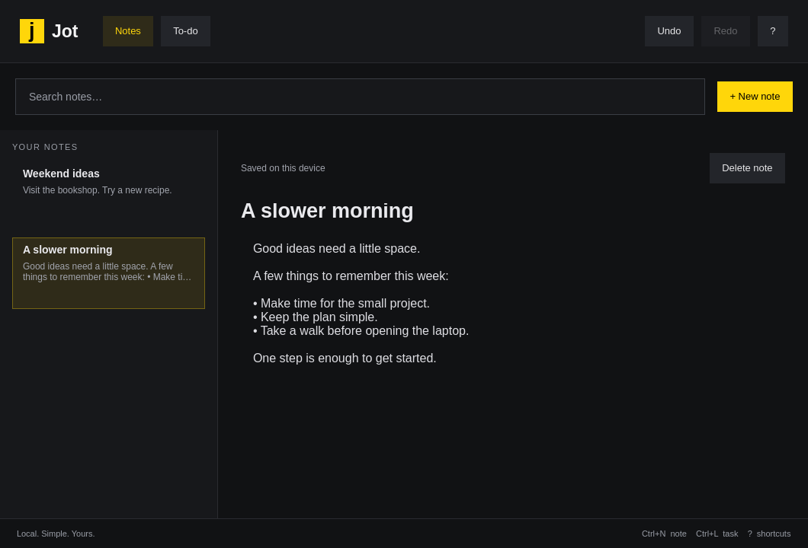

# Jot

Notes and to-dos for the Omarchy desktop. Capture thoughts in a plain-text
note, search them, and keep a checklist beside them. Everything stays on your
computer.

Open **Jot** from the app launcher (`Super + Space`), or run `jot open`.
Use **+ New note** to write a note. In **To-do**, type a task and press Enter;
check its box to finish it. Open, Done, and All filters keep the list manageable.
You can rename, edit, and delete both notes and tasks. Deletions ask first and
can be undone while the app remains open.

Notes save after a 400 ms pause and before switching notes or closing the app.
Task actions save immediately. Errors remain visible and unsaved note text stays
in the editor. Closing with unsaved text asks before discarding it.

## Keyboard

| Shortcut | Action |
| --- | --- |
| Ctrl+N | New note |
| Ctrl+L | Focus a new task |
| Ctrl+1 / Ctrl+2 | Notes / To-do |
| Ctrl+F | Search |
| Ctrl+S | Save now |
| Ctrl+Z / Ctrl+Shift+Z | Undo / redo |
| Space | New note or focus a new task |
| Enter in task input | Add task |
| Esc | Leave the text field |
| ? / F1 | Show all shortcuts |
| Q / Ctrl+Q | Quit |

Single-key shortcuts work outside text fields. Text fields keep their native
undo behavior while editing; the toolbar undoes whole saved actions. The last
50 actions are available during the current session. Changes from another
process clear session history to keep undo from replacing newer data.

## Data

The default file is `~/.local/share/jot/jot.json`, or
`$XDG_DATA_HOME/jot/jot.json`. Copy that file to back it up. Jot writes beside the
target and renames it atomically using Qt's QSaveFile, with a lock to serialize
multiple processes. Files are saved with permissions for the current user only.
Jot rejects invalid and unsupported data files without overwriting them.

CLI changes appear in the window within 1.5 seconds. Changes to different notes
and tasks merge. Conflicting edits to the same note show an error and preserve
the draft for copying. There is no network sync or account requirement.

## Build, test, install

Requires `base-devel`, `qt6-base`, `qt6-declarative`, `qt6-svg`, `qt6-wayland`,
and `xdg-desktop-portal` (included with Omarchy).

```sh
bin/build
bin/test
bin/install --noconfirm
```

The install script uses `makepkg -fsi` to install the Arch package, binary,
desktop entry, and icon. If terminal sudo authentication is unavailable, build
with `makepkg -fs` in `pkgbuild/` and use your desktop's authentication dialog
with `pkexec pacman -U PATH_TO_PACKAGE`.

`bin/test` covers persistence, autosave, tasks, undo, corrupt files, save failures,
concurrent clients, theme replacement and rounding, live language changes, and
mouse/keyboard interaction with the real QML window. Screenshots go to
`/tmp/jot-screenshots`; set `JOT_SCREENSHOT_DIR` to change that.

The app follows Omarchy's accent, window rounding, language, locale, and layout
direction live. English and Danish catalogs are included; other languages fall
back to English. Add catalogs under `src/i18n/` and list them in `resources.qrc`.

## Command line

Every command runs without a display, accepts `--json`, and exits 0 on success
or 1 on failure, with errors on stderr. List commands provide IDs.

```sh
jot notes list --json
jot notes add --title 'Ideas' --body 'Make something small' --json
jot notes update --id NOTE_ID --body 'A little more detail' --json
jot notes delete --id NOTE_ID --json
jot tasks list --json
jot tasks add --text 'Finish the first draft' --json
jot tasks update --id TASK_ID --text 'Finish the final draft' --json
jot tasks complete --id TASK_ID --json
jot tasks reopen --id TASK_ID --json
jot tasks delete --id TASK_ID --json
jot skill install --json
```

`notes update` preserves omitted fields. Use `--data-dir DIRECTORY` for isolated
automation or testing. `jot skill install` writes the bundled agent instructions
to `~/.agents/skills/jot/SKILL.md`.

Built in C++ and Qt Quick with qmake6. MIT licensed. Theme and translation
infrastructure follows the Omarchy app templates, with attribution in LICENSE.
